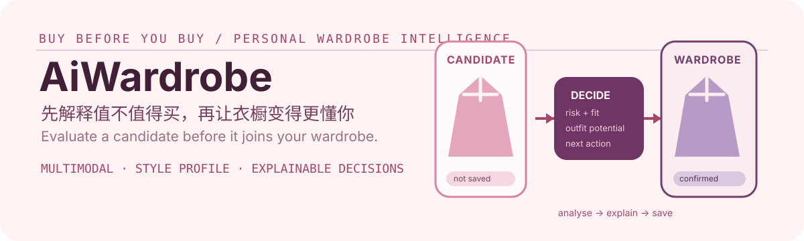

# AiWardrobe

  

  <strong>购买前 AI 衣橱决策助手</strong> 
  Understand whether an item is worth buying before it becomes part of your wardrobe.

## 这是什么 / What it is

AiWardrobe 不是只在买完后管理衣服，而是在购买前帮助用户判断一件商品是否适合自己。它将候选商品与现有衣橱、个人偏好、场景和天气关联，解释重复风险、闲置风险、搭配潜力和下一步建议。

AiWardrobe keeps a candidate separate from a confirmed garment. The wardrobe only changes after the user explicitly saves the item.

## 核心体验 / Core experience

- 邮箱登录、JWT 会话与轻量级风格偏好。
- 单件或批量衣物上传，进入可恢复后台任务，逐项显示阶段、错误与重试；识别结果待用户确认。
- 按场景、季节、温度和目标单品生成穿搭，支持历史与收藏。
- 通过商品 URL 或图片创建可恢复购买候选，查看依据、修正识别、记录购买/跳过/退货，并将确认拥有的候选关联到衣橱。
- 购买候选、搭配历史、反馈与穿着记录持久保存；衣橱报告根据实际穿着事件计算利用情况，数据不足时不推断长期闲置。
- 使用 Open-Meteo 天气服务，以及 Demo 或已配置的 Taobao/Tmall 商品搜索；推荐商品图片分析进入同一后台任务流程。
- 提供独立婚礼 MV 工作区：双方授权、照片与故事、AI 分镜和短镜头任务、共同审核、音乐与字幕、历史成片和私有导出；默认禁用外部模型。

## 工作流 / How it works

1. 录入已有衣物，AI 生成结构化标签，用户可修正。
2. 粘贴商品链接或上传候选图片。
3. 系统将候选与已就绪衣物、偏好和场景进行比较。
4. 用户阅读结构化解释并决定购买、跳过或保存候选。
5. 只有用户确认保存后，候选才进入正式衣橱并影响未来建议。

The product optimizes for informed decisions, not for forcing every candidate into a purchase recommendation.

## 快速开始 / Quick start

Windows 下可使用一键启动：

~~~powershell
.\start.bat
~~~

默认本地模式会启动独立 FastAPI API、衣橱 worker、婚礼 worker 和 Vite 前端，共用数据库、私有存储及 provider 配置；未配置时使用 SQLite 与本地存储。进程隐藏运行，日志保存在 `.local-services/`。停止服务使用 `start.bat stop-local`，会校验进程身份后停止本次记录的服务。

优化分支八项审核问题的修复与本地复验见[修复报告](docs/reviews/2026-10-01-optimization-fix-verification.md)；PostgreSQL 和真实供应商验证仍需在对应环境执行。[部署说明](docs/deployment-and-migrations.md)包含独立 worker、迁移与恢复操作。

- 前端 / Frontend: http://localhost:5174
- 后端 API / Backend API: http://127.0.0.1:8031/docs

也可以分别启动：

~~~powershell
.\start.bat backend
.\start.bat worker
.\start.bat wedding-worker
.\start.bat frontend
~~~

单独启动 API 不会消费任务，须另启 worker。

手动启动后端：

~~~powershell
cd backend
uv venv .venv --python python
uv pip install --link-mode=copy --python .venv\Scripts\python.exe -e ".[dev]"
.venv\Scripts\python.exe -m uvicorn app.main:app --reload --host 127.0.0.1 --port 8031
~~~

手动启动前端：

~~~powershell
cd frontend
npm ci
npm run dev
~~~

## 常用 API / Useful API

- POST /purchase/analyze：根据商品 URL 创建购买候选。
- POST /purchase/analyze-image：在 URL 图片提取失败时上传候选图片。
- POST /purchase/candidates/{id}/save：用户确认后将候选转换为正式衣物。
- POST /outfits/generate：按场景、季节、天气与目标单品生成搭配。
- GET /reports/wardrobe：获取衣橱分布、缺口和风险报告。
- GET 或 PUT /preferences/me：读取或修改风格偏好。
- POST /v2/tasks/garment-upload 与 POST /v2/tasks/purchase-analysis：提交可恢复的衣物或购买分析任务；GET /v2/tasks 查询进度。
- GET /v2/purchase/candidates：按游标查看购买记录；候选的修正、决定、关联衣橱和重新分析接口位于 `/v2/purchase/candidates/{id}`。
- POST /v2/feedback 与 POST /v2/wear-events：保存搭配/候选反馈和实际穿着记录。

前端使用 Node 24.14.x（`>=24.14.0 <25`）。婚礼 MV 的固定模型、worker、音乐授权配置与接口见[运行说明](./docs/wedding-mv.md)，工程证据和待完成的真人付费验收见[完成核查](./docs/wedding-mv-completion-audit-2026-10-01.md)。一键启动包含婚礼 worker，共享环境配置，婚礼模式默认禁用；正式制作使用 PostgreSQL 和私有存储。

## 模型、商品与天气配置 / Providers

Docker Compose 默认使用 AI_DEMO_MODE=true，方便本地验证。要启用真实穿搭模型，请在 .env 中关闭 Demo 并提供你的服务配置：

~~~env
AI_DEMO_MODE=false
OUTFIT_AI_PROVIDER=deepseek
DEEPSEEK_API_KEY=your-deepseek-key
DEEPSEEK_BASE_URL=https://api.deepseek.com
DEEPSEEK_MODEL=deepseek-chat
~~~

衣物识别可使用 OpenAI-compatible 多模态服务：

~~~env
AI_BASE_URL=https://your-compatible-provider/v1
AI_API_KEY=your-provider-key
AI_MODEL=your-vision-model
~~~

商品推荐默认可在 Demo 模式运行。若接入 Taobao/Tmall，请配置应用凭证；Open-Meteo 默认不需要密钥：

~~~env
SHOPPING_RECOMMENDATION_DEMO_MODE=false
TAOBAO_APP_KEY=your-taobao-app-key
TAOBAO_APP_SECRET=your-taobao-app-secret
TAOBAO_ADZONE_ID=your-adzone-id
TAOBAO_API_BASE_URL=https://eco.taobao.com/router/rest
WEATHER_PROVIDER=open_meteo
OPEN_METEO_BASE_URL=https://api.open-meteo.com
~~~

不要提交 .env 或真实第三方凭证。

## Docker / Full stack

~~~powershell
docker compose up --build
~~~

使用 Docker Compose 2.24 或以上；API 与两个 worker 共享 `.env`，实际授权音乐目录只读挂载。容器内的音乐目录、FFmpeg 与字体配置见婚礼运行说明。

默认服务：

- 前端 / Frontend: http://localhost:5173
- 后端 / Backend: http://localhost:8000
- MinIO Console: http://localhost:9101
- PostgreSQL: localhost:5432

Docker Compose 会启动独立的 `worker` 服务处理图片与购买分析任务。生产环境需单独部署 worker，并与 API 服务共享数据库、存储和 provider 配置。

## 数据库迁移与私有图片

开发环境在应用启动时自动应用版本化 schema migrations。生产环境不会自动改表：部署前需使用与应用相同的 `DATABASE_URL` 执行迁移，并将 `ENVIRONMENT=production`、至少 32 字节的随机 `JWT_SECRET` 和 provider/storage 凭证配置好。

~~~powershell
cd backend
python -m app.migrations upgrade
python -m app.migrations current
~~~

从旧版本升级时，先备份数据库和图片存储，再用与 API 相同的数据库、存储配置运行私有图片迁移。默认只校验，不写入；检查输出中的失败记录后再明确应用：

~~~powershell
python -m app.asset_migration
python -m app.asset_migration --apply
python -m app.asset_migration
~~~

最后一次 dry-run 应显示 `scanned: 0` 且 `failed` 为空。生产 API 启动会拒绝旧 schema 或仍引用公开存储键的私人图片。升级期间保留数据库和对象存储备份；迁移失败时先修复失败记录再发布生产 API。

更多设计与接口资料见 [系统架构](docs/architecture.md)、[v2 API guide](docs/api-v2.md) 和[文档索引](docs/README.md)。

## 验证 / Verify

后端：

~~~powershell
cd backend
python -m pytest
~~~

前端：

~~~powershell
cd frontend
npm test
npm run build
~~~

## 许可与第三方声明 / License & third-party notices

本仓库维护者的原创贡献采用[学习与非商业使用许可](./LICENSE)：个人学习与非商业研究可免费使用；任何商业使用均须先获得著作权人的书面授权。第三方依赖、字体、素材、数据与服务仍适用各自的许可证或条款，详见[第三方声明](./THIRD_PARTY_NOTICES.md)。

商业授权请通过本仓库的 GitHub Issues，或 [维护者主页](https://github.com/xiang949876499) 联系。

生产部署先运行 `cd backend; python -m app.migrations upgrade`，再启动 API 和两个 worker；生产启动只验证衣橱13及婚礼2两套 schema。Compose 已包含迁移先行服务。婚礼邀请披露、一次性重新进入、已批准故事修订及费用恢复规则见 [婚礼 MV 指南](docs/wedding-mv.md)。
