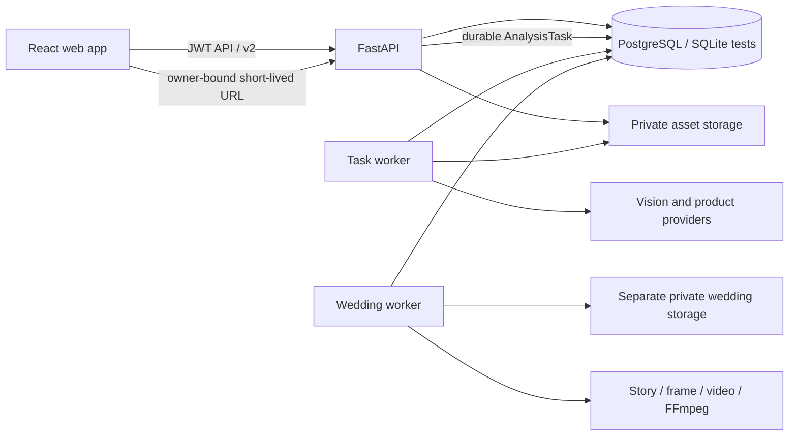

# AiWardrobe 架构

## 服务边界

FastAPI owns authentication, authorization, validation, resource reads, and task creation. The separate worker leases durable tasks and performs image processing, product extraction, provider calls, and result persistence. API and worker must share the same database, storage configuration, and provider settings. A worker restart leaves queued work in the database; an expired lease can be reclaimed safely.

## Core data flow

1. A browser upload is validated and stored as a private `StoredAsset`. A v2 request includes an `Idempotency-Key` and creates an `AnalysisTask`; the API returns `202` without waiting for model work.
2. A worker records each external `ProviderOperation`, advances the task through persisted stages, and stores sanitized result references. Ambiguous provider submission becomes `unknown` / `awaiting_resolution`; do not repeat it until reconciled.
3. Garment analysis remains pending user confirmation. Purchase analysis creates a versioned candidate snapshot with evidence, context revision, decision state, and explicit ownership state.
4. Feedback and wear records are append-only events with revocation. Their active revisions affect future decisions/reports while historical snapshots remain readable.

Legacy analysis creation routes are bounded adapters over this same task service. They wait at most 20 seconds, then return a task reference with `503 analysis_pending`; the default purchase screen uses v2 directly. Compatibility calls therefore share provider operations, submission quotas, and remote capacity reservations.

RunningHub/ComfyUI submission and collection are separate steps. Accepted task/prompt IDs are committed before collection; recovery queries never submit a new remote job. Queries are spaced by 30 seconds, with a 15-minute automatic window and a throttled explicit reconcile action. Local cancellation preserves unresolved remote reservations and image inputs until terminal verification. Worker result writes refresh cancellation state and validate the current lease, preventing late results from entering the wardrobe.

Purchase combinations use confirmed, owner-bound top/bottom/shoes, exclusions, and a shared known-season intersection; optional pieces are added only when compatible. Four-season/category buckets prune incompatible choices before enumeration and stop after three distinct valid combinations. Unknown seasons carry a warning; missing dimension evidence produces null values rather than a synthetic total. Snapshots retain stable resource IDs and rule/context versions; authorized reads hydrate private URLs and omit invalid combinations.

## Privacy and ownership

Private image bytes live in local private storage or a non-public S3-compatible bucket. Domain records reference asset IDs. List APIs return owner-authorized, short-lived asset URLs; the asset route checks the owner/signature before streaming. Asset cleanup waits until no references remain and the retention period has passed. Never expose private image directories as public static files.

Every user-facing resource query filters by the authenticated user. Cursor tokens are bound to that user and the request filters, and use stable `(created_at DESC, id DESC)` ordering. Invalid or cross-filter cursors are rejected.

`Garment.source_candidate_id` is the unique canonical ownership link; `PurchaseCandidate.owned_garment_id` mirrors it and survives deletion as a tombstone. Save/link/delete and reanalysis use the same User → candidate/garment lock order. SQLite reserves its writer before ownership reads; PostgreSQL uses row locks. `CandidateOwnershipOperation` (schema migration 13) stores semantic idempotency receipts for save/link. Old ambiguous rows require explicit linkage rather than image-based guesses.

The frontend treats a garment as trusted only when `status=ready`, `review_status=confirmed`, and `user_confirmed_at` is present. Purchase restoration selects only the newest task; selection and account generations prevent older polls, cursor pages, and delayed responses from replacing the current result.

## Wedding workspace and schema integration

The same API hosts wedding routes with separate owner/participant scopes. Invitation tokens enter through request bodies, participant sessions stay separate from wardrobe JWT storage, and every media read rechecks current consent. `wedding_worker` independently consumes story, frame, video and render jobs; it does not consume `AnalysisTask`. Exact portrait/frame/candidate provenance and reviews gate submission and completion. Known remote IDs recover with read-only queries; unknown submissions retain budget reservations. Immutable revisions preserve lineage and attempt ceilings. See [wedding contracts and operations](wedding-mv.md).

Both products share SQLAlchemy metadata but keep independent migration ledgers: wardrobe13 and wedding2. The explicit upgrade runs all steps through one locked connection/transaction. Generic wardrobe column upgrades exclude wedding tables so wedding foreign keys and timestamp provenance use their specific migrations. Production API and both workers only verify readiness, even when TESTING is set. Compose waits for the shared migration barrier; the local launcher records and stops all four processes by verified identity.

## Module map

| Area | Modules |
|---|---|
| HTTP/API | `backend/app/main.py`, `backend/app/routers/` |
| Versioned schema | `backend/app/migrations.py`, `backend/app/models.py`, `backend/app/schemas.py` |
| Durable processing | `backend/app/task_service.py`, `backend/app/task_ops.py`, `backend/app/task_worker.py` |
| Compatibility and recovery | `backend/app/legacy_tasks.py`, `backend/app/provider_recovery.py`, `backend/app/local_launcher.py` |
| Private images | `backend/app/asset_service.py`, `backend/app/asset_access.py`, `backend/app/asset_storage.py`, `backend/app/asset_gc.py` |
| Purchase context | `backend/app/decision_context.py`, `backend/app/purchase_analysis.py`, `backend/app/feedback_service.py` |
| Candidate ownership | `backend/app/candidate_ownership.py` |
| Wedding processing | `backend/app/wedding_worker.py`, `backend/app/wedding_creation.py`, `backend/app/wedding_render_worker.py`, `backend/app/wedding_accounting.py` |
| Browser app | `frontend/src/App.tsx`, `frontend/src/api.ts`, `frontend/src/PurchaseHistoryView.tsx`, `frontend/src/ResumablePurchasePanel.tsx` |

Schema and old-image upgrade steps are documented in [deployment and migrations](deployment-and-migrations.md); request examples are in the [v2 API guide](api-v2.md). The [main integration review](reviews/2026-10-02-main-integration-code-review.md) records current merge-source validation and review status; [prior repair verification](reviews/2026-10-01-optimization-fix-verification.md) remains historical. Real supplier and production-environment acceptance remain separate.
