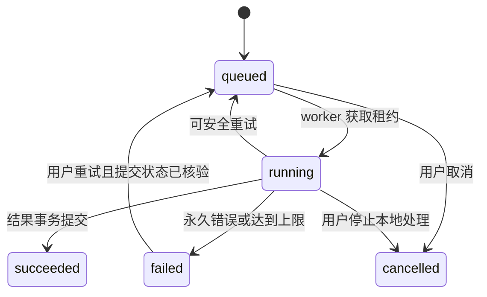

# AiWardrobe 优化 Spec：可信分析、购买决策与反馈闭环

**版本**：1.0

**日期**：2026-10-01

**状态**：工程实现已整合至本地 `main`；合并后修复复审状态见[main 整合审查](../../reviews/2026-10-02-main-integration-code-review.md)。本文保留目标行为与验收要求，环境验收须以具体证据为准。

**代码基线**：`f2deaec`
**来源**：[优化方案](../../optimization-proposal-2026-10-01.md)、当前代码、MVP 规范及上传规范。

## 1. 目标与范围

将现有购买前衣橱助手完善为：结果有可靠来源，建议对应真实衣物，历史可恢复，反馈影响后续决策。

### 1.1 必须达到的结果

- G1：远端识别失败不能伪装成真实成功；演示与真实数据分开。
- G2：长耗时任务可查进度、可恢复；重复操作不重复入库，不盲目重提收费调用。
- G3：购买建议使用明确偏好和真实衣橱；缺少资料时显示依据不足。
- G4：购买历史、反馈和穿着记录按账号持久化，支持撤销及跨设备使用。
- G5：输入、身份、图片访问、数据库迁移和列表读取满足真实部署要求。

### 1.2 交付范围

| 阶段 | 必须交付 | 退出条件 |
|---|---|---|
| M1：真实链路可靠 | 版本迁移、结果来源、图片安全、非 Demo 商品图片分析、持久任务、限流及图片隐私 | AC-01～AC-07 全部通过 |
| M2：形成决策闭环 | 有证据的个人决策、候选历史与决定、指定单品约束、反馈和穿着记录、revision与缓存失效 | AC-08～AC-14 全部通过 |
| M3：降低使用成本 | 登录前样例、统一上传、路由与模块拆分、分页、缓存效率和监控 | AC-15～AC-20 全部通过 |

不包含：支付与会员、自动购买、试衣、社区、微信小程序、完整穿搭日历、自动 LLM 用户画像、向量检索、微服务拆分。匿名真实模型试用后置；本版游客只查看样例，可填写输入并在登录后接续。

### 1.3 参考来源限制

最初三个参考项目的名称、URL 和原始文档尚未恢复；当前仓库及 Git 历史未保存 `docs/1.txt`～`4.txt`、`docs/FEATURES.md`。本 Spec 不宣称完成这三个项目的源码对照。搭搭和 XZ 只是旧方案点名的补充产品参考，相关官方来源及检索范围见优化方案第 7、10 节。

## 2. 现状与设计约束

已有能力：购买分析入口、商品 URL/图片分析、候选确认入库、报告、缺口推荐、轻量偏好、指定单品入口、天气、收藏和搭配历史。

需要修正的现状：识别失败会回退 Demo；上传直接写 ready/confirmed；真实推荐商品图片未接通；反馈只存 localStorage；候选缺乏可恢复入口；报告低利用项为空；指定单品在生成后追加；列表全量返回。

沿用 FastAPI、SQLAlchemy、Pydantic、React 18、Vite、TypeScript、现有存储适配与六种品类。生产使用 PostgreSQL，SQLite 用于开发及部分测试。先采用 PostgreSQL 持久任务表和单独 worker，不新增 Redis、Celery 或其他队列依赖；任务压力超过实测容量再独立评估。

界面遵守项目约定：玫红主色、Lucide 图标、可见标签、键盘焦点、移动底部导航与桌面侧栏。本版不重做视觉品牌；现有字体与约定的差异单独记录。

## 3. 用户流程

### 3.1 购买前分析

1. 用户提交商品链接或商品图；服务验证输入并创建任务。
2. 界面展示当前阶段；切换页面或刷新后可恢复任务。
3. 标签识别成功后，候选与正式衣物保持分离；用户可修正候选标签。
4. 有充分资料时展示个人建议、已有相似衣物和可用组合；资料不足时提示补充衣物、价格或偏好。
5. 用户选择保留、跳过或标记已购买；只有确认已拥有才加入衣橱。
6. 历史保留原分析快照；衣橱或偏好变化后标记过期，用户可重新分析。

### 3.2 衣物录入

单件、多张单件与一张多件入口独立。每张图片有独立任务和失败状态。识别成功生成待确认衣物；用户确认或人工填写后进入可用于个人决策的衣橱。批量只重试失败项，已成功项不重复创建。

### 3.3 反馈和穿着

满意、收藏、不满意、实际穿着是独立操作。不满意原因可选，可撤销；明确的「下次排除这件」需要用户选择具体单品。用户可一键记录穿过某套搭配，或选衣物记录穿着；记录可撤销，统计随之重算。

### 3.4 首次体验

未登录可看完整样例和输入入口。样例明确标识，不混入个人结果。开始真实分析或保存输入时登录；登录完成恢复当前页及输入。首次引导录入 3～5 件真实常穿衣物，示例基础款需用户确认确实拥有，不能自动加入衣橱。

## 4. 数据模型与不变量

下表是计划新增或扩展的领域模型；实施时先创建迁移，不能只依赖启动时 `create_all/ALTER`。

| 模型 | 核心字段与约束 |
|---|---|
| AnalysisTask（新增） | `id,user_id,kind,status,stage,input_refs,input_parameters,input_fingerprint,idempotency_key,attempt_count,lease_token,lease_expires_at,next_attempt_at,cancel_requested,error_code,result_refs,created_at,updated_at`；唯一 `(user_id,kind,idempotency_key)`；input_refs保存asset/候选/商品引用，input_parameters保存URL、mode及不可变输入版本；不存凭证 |
| ProviderOperation（新增） | `id,task_id,operation_key,generation,provider,submission_status,provider_task_id,request_fingerprint,request_parameters,result_refs,error_code,quota_reserved_at,slot_reserved_at,slot_released_at,slot_release_reason,reconciliation_evidence,created_at,updated_at`；唯一 `(task_id,operation_key,generation)`；每个拆分、逐件标签、可选解释调用独立记录并复用成功结果 |
| StoredAsset（新增） | `id,user_id,storage_key,mime_type,byte_size,width,height,sha256,thumbnail_asset_id,created_at`；业务记录引用 asset ID；对外不暴露底层对象 key |
| Garment（扩展） | `asset_id,analysis_source,provider,model_version,analyzed_at,user_confirmed_at,source_candidate_id`；`source_candidate_id` 唯一且可空；来源与审核独立 |
| PurchaseCandidate（扩展） | `analysis_status,decision_status,revision,requested_snapshot_revision,latest_snapshot_id,asset_id,analysis_source,actual_price,currency,owned_garment_id,ownership_state`；revision是可变业务字段版本，requested_snapshot_revision是快照请求序号；重分析创建时锁定候选分配请求序号，完成时不重新分配；原 `status` 仅作为旧接口兼容字段 |
| PurchaseAnalysisSnapshot（新增） | `candidate_id,snapshot_revision,wardrobe_revision,preference_revision,feedback_revision,rule_version,generated_at,coverage,evidence,decision`；快照不可覆盖；唯一 `(candidate_id,snapshot_revision)` |
| UserDecisionContext（新增） | `user_id,wardrobe_revision,preference_revision,feedback_revision,wear_tracking_started_at,wear_tracking_timezone`；user_id 唯一；revision 单调递增；首次创建穿着记录时固定观察起点 |
| UserPreference（扩展） | 保留旧文本字段；增加 `budget_min,budget_max,currency,avoid_categories`；金额为 Decimal，currency 本版固定 CNY；禁选品类用现有 Category 枚举 |
| FeedbackEvent（新增） | `id,user_id,target_type,target_id,snapshot_revision,value,reason_code,garment_ids,occasion,context,revoked_at,created_at,idempotency_key`；目标仅 candidate/outfit；context 保存反馈对应的规范化风格/天气证据；同用户、幂等键唯一 |
| WearEvent（新增） | `id,user_id,local_date,timezone,outfit_id,occasion,revoked_at,created_at,idempotency_key`，关联 WearEventItem 的 garment ID 快照；同用户、幂等键唯一 |
| WearEventItem（新增） | `wear_event_id,garment_id,garment_snapshot`；唯一 `(wear_event_id,garment_id)`；garment_id保留历史UUID，衣物删除不级联删除穿着证据，失效图片显示占位 |
| Outfit（扩展） | `result_revision` 默认1；保存校验后的组合与生成情境；重新生成创建新Outfit，收藏/固定不增加结果版本 |

`AnalysisTask.kind` 为 `garment_single/garment_split/purchase_url/purchase_image/recommendation_item/purchase_reanalysis`；`result_refs` 为 `{resource_type,id}` 列表。候选 `analysis_status` 为 `queued/running/ready/failed`，`decision_status` 初始considering。标签、价格、决定和拥有关系变更增加revision，任务进度不增加该值；expected_revision指此revision。金额字段可空，已填金额必须非负，budget_min≤budget_max；未知金额不能写0代替。反馈对候选使用snapshot_revision，对搭配使用result_revision，服务端校验版本存在。

业务不变量：

- 所有引用和查询都按当前 user_id 限定；不存在与属于其他用户统一返回 404。
- 个人决策使用 `status=ready AND review_status=confirmed` 且存在用户确认依据的衣物；演示资产始终不参与真实个人决策。
- 机器标签默认 `pending_review`；人工输入且用户提交确认可直接 ready。模型置信度是提示值，不解释为校准后的准确概率。
- 候选处理状态、用户购买决定、是否拥有、任务状态分别管理。标记 bought 不自动入库；入库需确认拥有。
- 候选分析快照保存生成时依据，历史界面不能悄悄将旧快照替换为当前结果。
- 删除衣物保留历史引用的 ID 和失效标记；不能因为重放保存请求而重新创建已删除衣物。
- asset 删除按实际引用检查，不依赖容易漂移的前端计数；删除最后引用后进入回收队列。

## 5. 持久任务契约

### 5.1 状态与阶段

任务 `status` 为 `queued/running/succeeded/failed/cancelled`。`stage` 为 `validating/downloading/preprocessing/recognizing/scoring/persisting/awaiting_resolution`，阶段只描述正在做什么；任务成功生成的衣物仍可能待审核。

每个ProviderOperation的 `submission_status` 为 `not_submitted/submitting/submitted/unknown/completed/failed`。worker先提交submitting状态再调用远端；收到ID后写submitted，完成后验证并持久保存结果。已受理但响应丢失、提交后进程崩溃或不能确定受理结果时写unknown。任务响应的submission_status是当前操作的汇总提示，有unknown时优先显示unknown，不替代逐调用记录。

任务创建前先存储并验证输入资产，再在事务中关联input_refs和不可变input_parameters；事务失败则临时资产按24小时策略回收。URL、mode、item_id、candidate标签版本与价格均保存，不依赖请求结束后的内存。拆分输出按稳定输出序号生成 `split/tag:0/tag:1/.../explain` 操作键；同操作成功后重启复用原结果，不能重新调用。确需再次调用已终止失败的远端操作时创建新generation，并消耗新提交配额；已受理不明的操作禁止新generation。



unknown不表示failed：任务保持running+awaiting_resolution，释放执行租约并仅允许只读核验，不允许新收费提交。每30秒核验一次，持续15分钟后暂停自动核验，显示「提交状态待确认」及action_required=true；GET只读本地记录，用户可通过reconcile接口再次触发只读供应商查询。无法查询的供应商直接暂停并提示需要外部核实。只有供应商确认未受理，或具备有效供应商幂等机制，才允许重新提交；不能让普通用户凭未验证的输入把unknown改成可重提。

远端并发预留的释放与原操作重新提交分开：确认终态/未受理可正常释放；供应商有可验证最大执行时限时，adapter保存该依据，到期可释放。无法查询也无执行上限依据时，进入运维核验列表。受限本地运维工具可显式释放并发预留，必须记录操作者、时间、理由和核验材料；不能通过普通用户API执行。该操作只解除系统预留，不认定远端已停止、退款或未受理，submission_status仍为unknown且禁止原操作重提，后续迟到结果仍受取消/版本校验。本版的4槽限制针对系统已追踪预留，不能在未知远端执行状态下保证实际远端并发数。

### 5.2 并发、恢复与取消

- PostgreSQL worker 以行锁获取任务；租约默认 60 秒，10 秒心跳，写入结果必须校验 lease_token，过期 worker 无权提交。
- 租约到期：未提交远端的任务可重新领取；已提交任务恢复查询；submitting/unknown 任务先核验，不能直接重提。
- 每任务最多3次安全处理尝试（含用户重试），自动间隔2秒、10秒并加小幅随机抖动；只重试已明确未受理的连接失败、可验证的暂时失败或本地处理失败。校验失败、永久错误不重试；达到上限retry返回409 `task_retry_exhausted`，重新发起分析需用户明确创建新任务和新幂等键。
- 用户取消后，本地任务立即cancelled并停止业务结果入库；ProviderOperation继续单独核验远端和清理迟到结果。能取消远端则发送取消请求，不能取消或提交未知则显示「已停止本地处理，远端仍可能完成」；不宣称已经退费或停止计费。已succeeded任务取消返回409 `task_already_completed`，不删除成功资源。
- 任务、生成记录、asset 引用和结果关联在同一数据库事务提交；阶段处理中不长期持有事务或数据库锁。
- 重试沿用任务 ID 和已有远端任务；`attempt_count` 统计新的处理尝试，远端轮询不增加尝试次数。
- 本地成功幂等与供应商执行幂等分别验证；不能对不支持幂等的供应商承诺绝对只调用一次。

## 6. API 与兼容

### 6.1 版本原则

新契约使用 `/v2` 前缀，前端增加对应 Vite 代理。现有 `/uploads`、`/purchase`、`/garments` 等路径保留成功响应形状；不能在原路径将 `201 + Garment` 直接替换成 `202 + Task`。

新前端优先使用v2；旧创建接口作为受限同步适配器调用相同任务服务，最多等待20秒。成功仍返回原领域资源；未完成返回503、`detail.code=analysis_pending`和task_id，不能再次发起供应商调用。旧客户端未带幂等头时，以用户、操作、规范化输入摘要构造24小时兼容键，复用同一进行中或已完成任务；主动重新分析使用v2明确接口。旧保存接口复用唯一入库服务；重复保存返回既有衣物，已删除关联返回409。旧分析格式无法表达空分数/不足依据时返回409 `evidence_insufficient`，不能造一个整数分数维持格式。

所有新建任务、重试、保存/关联入库、反馈和穿着创建要求 `Idempotency-Key`，UUID字符串；取消、撤销为资源级幂等操作，reconcile只允许只读核验。相同用户/操作/键且输入摘要一致返回原结果；摘要不同返回409 `idempotency_conflict`。任务输入摘要包含验证后的文件内容及影响处理的参数。每次先验证身份/资源权限，再检查幂等重放，再检查expected_revision；重放不能因首次成功已改变revision而失败。

### 6.2 接口清单

以下均要求登录；公开样例无需登录，asset content路径接受范围严格受限的短期资产签名。表中未列出的现有接口继续保留。

| 方法与路径 | 请求 | 成功响应 |
|---|---|---|
| POST `/v2/tasks/garment-upload` | multipart：file、mode=`single/split` | 202 Task；多文件由前端逐张创建任务 |
| POST `/v2/tasks/purchase-analysis` | JSON：url；或 multipart：file、可选 product_url | 202 Task；同一路径按 Content-Type 选择明确 Schema |
| POST `/v2/tasks/recommendation-analysis` | item_id | 202 Task；检索已有推荐商品的图片后分析 |
| GET `/v2/tasks/{id}` | 无 | 200 Task；含 stage、错误及 result_refs |
| GET `/v2/tasks` | status、cursor、limit | 200 分页任务，恢复跨设备在途任务 |
| POST `/v2/tasks/{id}/retry` | 空 JSON；要求新 Idempotency-Key | 202 原任务；受安全重试规则限制 |
| POST `/v2/tasks/{id}/cancel` | 空 JSON | 200当前任务；已succeeded返回409，其余终态幂等返回200 |
| POST `/v2/tasks/{id}/reconcile` | 空 JSON | 202已登记只读核验请求；每任务30秒内重复请求不新增查询 |
| GET `/v2/purchase/candidates` | decision_status、cursor、limit | 200 分页候选 |
| GET `/v2/purchase/candidates/{id}` | 可选 snapshot_revision | 200 候选、快照、过期标记和拥有关系 |
| PATCH `/v2/purchase/candidates/{id}` | 可修正标签、actual_price、currency；expected_revision | 200 新候选版本；标签变更使决策过期 |
| PATCH `/v2/purchase/candidates/{id}/decision` | decision_status、expected_revision | 200；冲突 409，无新收费调用 |
| POST `/v2/purchase/candidates/{id}/reanalyze` | 空 JSON | 202 Task；优先复用有效视觉标签 |
| POST `/v2/purchase/candidates/{id}/save` | confirm_owned=true；确认后的 tags；expected_revision | 新入库 201，重复同结果 200；返回 garment_id |
| POST `/v2/purchase/candidates/{id}/link-owned-garment` | garment_id、confirm_owned=true、expected_revision | 200；仅用于历史关联核对，关联已拥有衣物而不创建新衣物 |
| POST `/v2/garments/{id}/confirm` | 确认后的 tags | 200 Garment；人工确认记录写入 |
| PUT `/v2/preferences/me` | 原偏好及结构化预算/禁选品类 | 200 偏好和 revision |
| POST `/v2/feedback` | target_type、target_id、snapshot_revision、value、可选 reason_code/garment_ids/occasion | 201 FeedbackEvent |
| DELETE `/v2/feedback/{id}` | 无 | 204；幂等撤销 |
| POST `/v2/wear-events` | local_date、timezone、outfit_id 或 garment_ids、可选 occasion | 201 WearEvent |
| GET `/v2/wear-events` | from、to、cursor、limit | 200 分页记录 |
| DELETE `/v2/wear-events/{id}` | 无 | 204；幂等撤销 |
| GET `/v2/garments`、`/v2/outfits` | cursor、limit、现有筛选及 q | 200 `items,next_cursor,has_more` |
| GET `/v2/reports/wardrobe` | 无 | 200 报告及 data_coverage；真实使用统计可为空 |
| GET `/v2/assets/{id}/access` | variant=original/thumbnail | 200 `url,expires_at`；验证Bearer与所有权后颁发5分钟签名 |
| GET `/v2/assets/{id}/content` | variant、asset_token | 200图片内容；验证专用资产签名、当前引用及删除状态；禁止接受普通JWT代替资产签名 |
| GET `/v2/examples/purchase` | 无 | 200 固定公开样例；不含任何用户数据 |

`decision_status` 为 `considering/bought/skipped/returned`。considering 可转 bought/skipped；bought 可转 returned；skipped 可回 considering；returned 可回 considering。状态更新使用 expected_revision；重复相同状态是无副作用成功。

入库是独立操作：数据库锁定候选并建立唯一 source_candidate_id 关联；ownership_state 为 `never_saved/linked/removed/legacy_unlinked`。已linked时重复保存返回既有衣物，不通过save修改其标签。衣物删除后置 removed并保留关联墓碑；普通重试返回 409 `owned_garment_removed`，本版不提供自动恢复。legacy_unlinked 返回409 `ownership_link_required`，用户通过核对接口关联自己已有的衣物；该接口锁定双方记录并验证未存在其他候选绑定，不自动猜测或创建。退货不自动删除衣物，界面提示用户确认移除，避免替用户改动衣橱。

### 6.3 响应例子

```json
{
  "id": "task-uuid",
  "kind": "purchase_image",
  "status": "running",
  "stage": "recognizing",
  "submission_status": "submitted",
  "cancel_requested": false,
  "action_required": false,
  "attempt_count": 1,
  "error": null,
  "result_refs": [],
  "poll_after_seconds": 2
}
```

```json
{
  "detail": {
    "code": "provider_submission_unknown",
    "message": "提交状态待确认，请先查询结果。",
    "retryable": false,
    "retry_after_seconds": 30,
    "task_id": "task-uuid"
  }
}
```

错误统一保留 HTTP 状态及 code：401 未登录；404 无可访问资源；409 版本/幂等/拥有关系冲突；413 超限；415 格式不支持；422 无效输入；429 限流；502 供应商或解析失败；503 暂不可用。用户文案不得暴露凭证、内部路径或供应商原始敏感响应。429 同时返回 Retry-After。

## 7. 购买决策契约

### 7.1 来源与覆盖度

`analysis_source` 为 `remote/manual/demo/legacy_unknown`，manual 必须有用户确认记录；provider 和模型版本可空但不能编造。远端失败使用明确 error_code，不自动写 demo。演示只允许显式演示任务；在生产私人分析路径无法请求演示来源。

每份快照包含：已确认衣物数量、有效偏好项、缺失资料、个人分析可用维度、实际价格来源、来源标签和rule_version。空衣橱时duplicate_risk、gap_fill、outfit_potential、idle_risk及总分为null；可显示通用品类/场景说明并标记insufficient。有效禁选/超预算硬约束仍可产生skip，其余情况为consider；不能因为缺衣橱资料忽略已明确的预算或禁选。

有衣物仍需按维度判断：重复检测只能覆盖已录入衣物；缺少互补品类时不声称完整搭配；未知标签不算不匹配；非数值预算不参与数值比较。文案始终使用「已录入衣物中」，避免声称了解用户全部衣橱。

### 7.2 决策规则 v1

沿用现有相似度、缺口、搭配基础规则，记录规则版本；先完成以下确定行为，模型只写解释，不改结论：

1. 候选属于用户明确 avoid_categories → skip，原因指向该偏好。
2. 实际价格已知且超过用户 budget_max → skip，显示超预算金额；未知价格 → budget_match=null，不生成估计售价。
3. 资料不足 → consider；不足维度及总分为 null。
4. 其余保留基础分 `0.30×(100-重复分)+0.35×缺口分+0.35×搭配分`；有可匹配的明确 style/scene 时各加 5，已匹配的情境负反馈各减 5，总调整范围 -15～10，结果限制 0～100。匹配采用规范化精确标签，不使用自由文本猜测。
5. 先应用负约束再排序；分数≥75、重复分<80、且缺口≥55或搭配≥70 时 recommend；分数<50或重复分≥80且缺口<65 时 skip；其余 consider。分数是规则辅助值，不宣称为购买成功概率。

`suggested_price` 在 v2 为 null；本版只展示真实 actual_price 与结构化预算。未来有可信价格数据时需独立修订 Spec，不延用当前品类常量生成精确价格。

### 7.3 真实组合与目标单品

候选搭配最多三组，允许零组。完整组合至少有 top、bottom、shoes；每类最多一件，outerwear/bag/accessory 各最多一件。候选单独以 candidate_id 引用，其他单品必须为该用户已确认衣物。只展示满足标签季节交集、未命中禁选类别和明确排除的组合；未知季节给出未核验提示，不作为明确季节匹配证据。

指定已有单品的搭配在生成前传 garment_id 和品类约束，生成后验证目标存在、ID 归属和上述组合约束。无有效组合返回 recoverable error `no_valid_combination`，引导补录，不能事后追加目标制造冲突组合。解释基于校验后的最终组合生成；解释失败可用规则摘要，不影响可靠的组合结果。

## 8. 反馈、穿着与缓存

FeedbackEvent.value为helpful/not_helpful；reason_code为style_mismatch、weather_mismatch、missing_item、duplicate、avoid_item或other。原因可空；helpful的reason_code为空。avoid_item必须附有效garment_ids，并明确勾选「下次排除这些单品」；只有该操作形成单品负约束。

反馈context由服务端从目标结果保存，不接受客户端伪造：style_labels、occasion、temperature_bucket和rule_version。temperature_bucket为`cold(<10°C)/mild(10～<20°C)/warm(20～<30°C)/hot(≥30°C)`，未知温度为空。只有未撤销的not_helpful事件参与本版负约束及减分，helpful仅记录。style_mismatch仅在相同occasion及风格标签重合时减分；weather_mismatch仅在相同occasion及已知相同温度档时减分；每个情境原因最多计一次，撤销后移除影响。其余原因仅记录/提示，不能自动扩展为全局禁选；missing_item触发引用检查，不从反馈自行删除衣物。

旧 localStorage 反馈不自动上传：无法证明账号和归属，避免导入其他账号的数据。新反馈落库后前端显示保存结果，失败可重试，不能只在本地显示成功。

穿着输入必须使用合法 IANA timezone；local_date 不晚于该时区当前日期。outfit_id 与 garment_ids 二选一，选择搭配时保存当时成员快照；成员必须属于当前用户。次数按不同的有效 local_date 去重，同日多事件不重复计同一衣物。

首次创建穿着记录时，观察起点按服务端时间及提交的合法时区固定；回填旧日期和撤销不提前或重置起点。报告增加 `wear_data_status=none/insufficient/available`。观察起点后满30天且期间至少5个有效记录日期时为 available；否则仅展示已记录穿着天数，低利用列表不下结论。available 时，入库及观察起点均已满30天、近30天没有穿着记录的衣物列为「近期未记录穿着」，不是断言未穿。无有效记录显示暂无数据；撤销事件即时重算。本版不计算每次穿着成本，因当前没有完整购买价格记录。

衣橱新增、确认、编辑和删除原子增加 wardrobe_revision；有效偏好变更增加 preference_revision；反馈创建/撤销增加 feedback_revision。规范化无变化和相同幂等写入不重复递增。视觉缓存按规范化图像 hash+provider+model_version，默认有效30天，并经asset所有权检查后使用；个人决策缓存按 user_id、candidate 标签版本、actual_price、三个 revision、rule_version，有效30分钟。天气参与时额外加入天气快照时间/地点键。

wear 事件影响报告使用统计，不影响本版购买评分，不要求增加 feedback_revision。生成开始捕获衣橱、偏好、反馈与候选版本，并使用同一份输入快照完成计算；结果提交时版本变化则保存为stale历史结果。历史快照继续可读，但 revision 不一致显示 stale。重新分析保留旧快照，latest_snapshot_id只指向最高请求版本的已完成结果，较旧任务的迟到结果不能覆盖较新任务结果。

## 9. 输入、隐私与配额

- 所有图片入口允许 JPEG/PNG/WebP，单文件≤10 MiB，解码后≤24百万像素，批次≤20张；前端同时处理/上传最多3张。
- 预处理将最长边缩至2048像素；JPEG/WebP目标≤2 MiB，不达到则继续降尺寸，最低最长边1024像素，仍超限返回明确错误。带透明背景的 PNG 保留透明，不转 JPEG，按尺寸缩放后仍超10 MiB则拒绝。
- 页面下载≤2 MiB，图片下载≤10 MiB，重定向最多3次；每次校验协议、DNS结果、重定向和真实连接目标，拒绝本机、私网、链路本地与元数据地址。开发用本地服务只能通过明确配置的供应商 base URL 接入，不能通过用户商品 URL 绕过。
- 图片按解码后的格式设置MIME，清理EXIF，生成最长边480像素的真实缩略图。资产签名有效期5分钟，限定asset_id、user_id、variant和用途，响应禁止共享缓存；本地/S3都通过受保护资产服务，不公开挂载私人原图。
- 当前前端使用localStorage Bearer，普通img不能携带该头。新前端通过带Bearer的资源读取/access取得短期URL再赋给img，过期重新取得；不把普通JWT放进URL。旧领域响应在读取时也产生短期image_url/thumbnail_url；历史快照保存asset ID而非过期签名。资产迁移和动态响应上线后，同一发布步骤关闭原公开static挂载，禁止为了兼容保留私人图片公开入口。
- 无业务引用的临时/失败资产保留24小时后清理；已删除最后引用的资产24小时内删除。仍被候选、衣物或在途任务引用时保留，历史 ID 不等于继续保留私人原图。
- 生产启动拒绝 `change-me`、空值及不足32字节的 JWT 密钥；凭证只从环境配置读取。
- 登录：同邮箱或IP每10分钟最多10次；验证码发送：同邮箱60秒冷却、每小时5次，同IP每小时20次；验证：每个验证码最多5次失败。过期/消费后均不能再次验证。
- 模型任务：每用户最多2个实际执行的running任务、20个queued任务；awaiting_resolution不占worker执行槽。每小时最多20次新ProviderOperation远端提交，拆分、逐件标签和模型解释各计一次；轮询不计。每供应商远端并发默认4，unknown仍保留远端并发预留，核验终态或确认未受理后才释放；本地取消不证明远端结束。
- 新任务创建时队列或小时额度已满返回429；已受理任务在下一操作额度不足时保存进度并queued，next_attempt_at指向额度恢复时间，不重跑已完成操作。可选解释无额度可直接采用规则摘要。批量只控制单图并发，不同时展开所有收费调用。
- 同一任务恢复轮询不消耗新提交配额；明确的新远端提交才计数，unknown 暂占该次额度，不能立即退回诱发重复提交。采用数据库原子计数/锁定，过期清理分 scope。

上述限制为本版设计默认值，应配置化并在部署前验证；公开游客接口不调用远端模型，避免新增匿名收费配额流程。

## 10. 前端契约

新增路由：`/`、`/wardrobe`、`/wardrobe/:id`、`/purchase/new`、`/purchase/:id`、`/outfits`、`/outfits/:id`、`/reports`、`/history`；任务恢复使用任务列表及 task ID。购买和搭配历史在同一历史入口中切换。

结果页先显示结论、主要证据和动作，再显示可用维度。依据不足不能显示0分、100%置信或假相似衣物。候选的保留、购买决定、确认拥有使用不同文案。

状态区分：未录入、筛选无结果、加载中、读取失败、资料不足、任务进行中、远端提交未知。筛选无结果提供清除筛选；失败提供安全的重试或人工修正入口。

前端请求错误保留 status/code/retry_after；401 集中退出并清理本账号缓存，在明确登录成功后恢复安全输入。组件卸载、切换账号和新查询取消旧请求，旧响应不能覆盖新页面。批量删除展示逐项结果并刷新真实状态。

默认分页50条，最大100条；按 `(created_at DESC,id DESC)` 游标，游标绑定用户和筛选条件，条件变更重新起页。文本及标签筛选在服务端处理，不能只筛当前页；返回列表不携带原图字节。浏览器返回恢复筛选与滚动。

按 auth/wardrobe/purchase/outfits/reports/shopping 拆分页面和 hooks，App 负责壳层、路由及身份。导航具备 aria-current、选择具备 aria-pressed；任务区域 aria-busy，完成/错误用 aria-live；路由切换将焦点移到主标题。375px视口与200%缩放下关键操作不得被底部导航遮挡。

## 11. 模块责任

| 现有模块/计划新模块 | 责任 |
|---|---|
| models.py、schemas.py、计划新增 migrations/ | 模型、响应契约与版本化迁移；生产迁移单独执行 |
| 计划新增 task_service.py、task_worker.py、task_ops.py | 任务创建、幂等、租约、恢复、提交未知和取消；worker单独进程；受限运维工具负责有审计的并发预留释放 |
| 计划新增 image_inputs.py、asset_service.py，扩展 storage.py | 统一安全下载、格式/尺寸、缩略图、私有访问与回收 |
| ai.py、runninghub.py、comfyui.py | provider适配、来源和结构化错误；不负责自动伪装演示成功 |
| purchase_analysis.py、routers/purchase.py | 可核验规则、不可变快照、候选决定及唯一入库 |
| shopping_recommendations.py、routers/shopping.py | 真实商品图链路、单项失败和分层缓存 |
| 计划新增 feedback_service.py、wear_service.py | 反馈、明确排除、撤销、穿着成员快照及使用统计 |
| preferences.py、wardrobe_report.py、routers/outfits.py | 结构化上下文、报告覆盖度和生成前目标约束 |
| rate_limit.py、security.py、main.py | 原子配额、身份边界、生产配置校验；移除公开私人图片挂载 |
| frontend/src/api.ts、types.ts、计划新增 features/ | v2契约、路由、任务恢复、历史/反馈、分页和状态展示 |

文件表仅定义边界，不是已创建文件或逐步实施计划；各阶段实施计划单独拆分。

## 12. 迁移与发布

先引入版本迁移及 PostgreSQL 升级验证，再创建新字段/表。旧 JSON 原样保留，新字段允许回填；旧的 schema backfill 不能给 v2未知数据补造价格或分数。

历史有明确用户确认记录的衣物保留确认；没有确认依据的 AI 衣物标为 legacy_unknown/pending_review，记录仍可查看和编辑，通过批量确认后再进入个人决策。明确 Demo 衣物单独标识并排除。不能用旧 confirmed 字符串推断用户确实确认过。

旧 saved 候选缺少可靠 garment 关联时不能凭同图猜测归属；ownership_state=legacy_unlinked，提供关联已有衣物的核对入口，保存重放不得再次入库。确认删除过的关联才为removed。旧用户偏好文本保留，不能自动把自由文本预算转换为数值约束。

先发布迁移与兼容服务，再发布worker，随后切换新前端。回退前先暂停新收费提交并排空/核验在途任务；数据库优先前向修复，不能自动删除新事件或降级丢失快照。只有具备新版任务/asset边界的兼容服务版本可承接回退，不回退到公开私人图片的旧部署。

扩展现有 SQLite 导入工具，覆盖偏好、候选、推荐及其引用，生成迁移计数和失败报告；导入采用事务及唯一键防重。生产新库、旧 Postgres 升级和 SQLite导入均需独立验证。

## 13. 验收矩阵

| ID | 可复现的场景与必须结果 |
|---|---|
| AC-01 | 远端超时、非法JSON、缺凭证：真实分析均不回退成已确认Demo；有明确失败码及修正入口 |
| AC-02 | 关闭推荐Demo，以模拟的真实图片响应完成下载→标签→候选；一个坏图不影响其他项 |
| AC-03 | 任务处理中刷新/切页/重启worker后可恢复；租约失效worker不能写入结果 |
| AC-04 | 同幂等键重复请求只生成一份资源；同键不同输入409；模拟远端已受理但响应丢失后不自动重提；有审计地释放未知操作并发预留后仍不能重提原操作 |
| AC-05 | 直接私网URL、重定向私网、DNS目标变化、伪图片、超字节/像素图均在AI调用前拒绝 |
| AC-06 | 无有效身份或资产签名无法读asset，其他账号不能取得签名；普通img能使用受控URL，签名过期后需重新鉴权；最后引用删除后24小时内清理，仍有引用不会误删 |
| AC-07 | 弱JWT生产启动失败；并发不突破配额；1分钟窗口操作不会清空10分钟记录；Postgres新旧库迁移通过 |
| AC-08 | 空衣橱返回insufficient与null分数，无硬约束时consider，有有效超预算/禁选时skip；未知价格不显示精确建议价 |
| AC-09 | 每个相似项与搭配引用归属正确；指定目标生成前参与约束，组合无同类冲突、解释对应最终结果 |
| AC-10 | 候选切页、刷新、换设备可恢复；保留/标记购买不会自动入库；旧快照可读、过期可见 |
| AC-11 | 并发确认同候选只有一件Garment；删除其衣物后重放保存不会重新创建；决定版本冲突409 |
| AC-12 | 反馈跨设备存在、跨账号隔离；明确排除影响下一次选择；撤销还原影响，旧本地反馈不混入 |
| AC-13 | 同日穿着同件不重复计次，撤销后重算；无记录/不足30天报告不声称长期闲置 |
| AC-14 | 新增相似衣物、修改预算或撤销反馈后决策缓存失效；视觉标签可继续复用，历史快照不被覆盖 |
| AC-15 | 未登录能看完整公开样例；登录后输入继续；示例基础款不自动成为用户衣物 |
| AC-16 | 各图片入口遵守一致限制，透明PNG保留透明；20张批次最多3张同时处理，失败只重试失败项 |
| AC-17 | 衣物与搭配首屏最多请求50条；服务端执行筛选，游标绑定用户/过滤条件并稳定翻页；筛选变化重置。候选、任务、反馈和穿着提供对应服务端分页接口 |
| AC-18 | 401不依赖英文文案识别；切账号/请求乱序不会覆盖；5件删除中2件失败时能看到逐项真实结果 |
| AC-19 | 键盘完成上传→查询→修正→确认；读屏识别阶段和选中状态；375px及200%缩放关键操作可见 |
| AC-20 | 可用任务ID追踪各阶段耗时、provider来源、降级、重试与调用成本；日志不含凭证或用户图片内容 |

测试分层：规则及状态单元测试；非Demo provider契约模拟；PostgreSQL并发/迁移集成测试；React行为测试；真实浏览器关键流程。真实供应商验证需要独立的成功、超时与任务查询记录，不能用Demo通过替代；收费验证不由本次文档任务执行。

历史基线：上轮审查实测后端84项、前端30项测试及构建通过，主要基于SQLite/Demo/mock。该数字只表示实施前基线。

## 14. 实施与验证快照

2026-10-02 当前实现已合入本地 `main`；双 schema 在同一锁和事务中升级，生产只验证，两个独立 worker 共用配置。最新测试、独立代码审查与本地 PostgreSQL 证据见[main 整合审查](../../reviews/2026-10-02-main-integration-code-review.md)。真实付费供应商、生产环境、读屏及负载验收尚未执行。

以下为 2026-10-01 优化阶段的历史快照，不作为合并后统计。历史实现位于 `codex/aiwardrobe-optimization` 分支。2026-10-01 审核 R1～R8 已修复，本地全量验证为后端 pytest **215 passed**、前端 Vitest **58 passed**、`npm run build` 通过、`python -m compileall -q app` 通过。schema version 为 13；回归覆盖持久兼容入口、安全重试、可查询供应商只读恢复/取消、所有权并发、真实组合、null 契约和账号/请求隔离。

PostgreSQL 服务不可用，PostgreSQL 新库/既有库迁移和并发集成测试未运行；SQLite 新库/升级及独立会话竞争有测试。真实付费 provider 恢复/计费尚未验证，成本只展示有效供应商回报。真实浏览器已完成独立 worker 上传到确认、空衣橱购买/刷新/保存/组合/删除冒烟；375px 和 640px 等效重排无横向溢出，移动键盘导航通过。读屏、实际浏览器 200% 缩放、全部页面和负载指标尚未验收。相应状态见[实施计划](../plans/2026-10-01-aiwardrobe-optimization.md)与[修复报告](../../reviews/2026-10-01-optimization-fix-verification.md)。

## 15. 指标与完成定义

产品漏斗：进入首页→提交候选→任务完成→查看证据→保留/跳过/确认拥有→后续反馈。记录完成率、首次结果时间、7日再次分析率、反馈覆盖率，先建立基线再设置增长目标。

质量分别测量：视觉字段正确率、引用归属正确率、证据完整性、用户采纳与反馈；准备50～100条人工评审样本，涵盖空衣橱、重复款、禁选、预算冲突和错误标签，不把主观购买决定压成一个所谓准确率。

任务创建接口在文件接收完成后P95目标≤2秒；真实模型完成耗时按provider报告P50/P95，不在未测量前承诺统一时限。分页接口在2000件测试数据、20并发下P95目标≤500ms；记录硬件和数据库配置。成本包含失败和重试，仅在有效来源记录齐全时报告。

阶段完成必须满足对应AC、迁移与兼容检查、现有关键回归、文档同步和可追踪的验证结果。Spec写完只表示定义完成；业务能力完成以实施后的验收证据为准。
